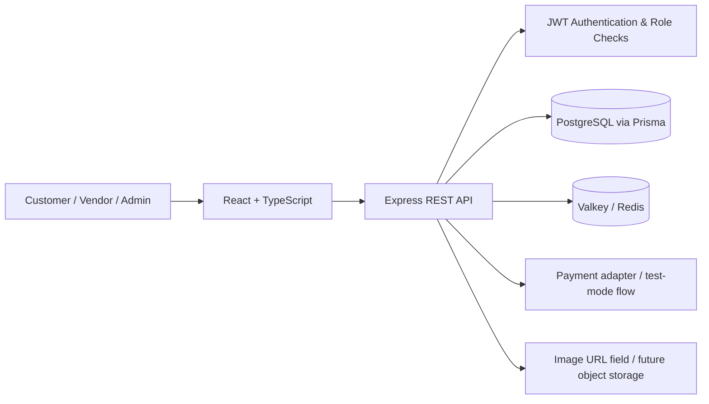
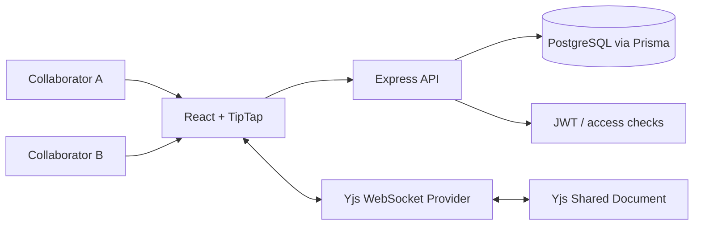

# Architecture & Data Flow

## FS-01 — Multi-Vendor Marketplace

**Request flow:** Browser → Express API → authentication/authorization → Prisma → PostgreSQL. Cache is configured for cart-related operations. The current deployed build should be treated as a demonstration environment, not a production payment system.

**Core data entities:** User (CUSTOMER/VENDOR/ADMIN), Product (vendor-owned), Order, OrderItem, Review, Coupon. OrderItem stores product name, vendor ID, quantity and unit price as a purchase-time snapshot.

## FS-02 — Real-Time Collaborative Workspace

**Collaboration flow:** Each editor connects to the Yjs WebSocket endpoint; Yjs merges concurrent document updates. REST endpoints handle application metadata and access-controlled operations. Verify persistence and reconnection behavior in the live environment before claiming durable collaboration.

## Deployment topology

Both clients are Render Static Sites. Each REST API and the FS-02 Yjs process are Render Node web services in Singapore. FS-01 uses a Render PostgreSQL database and Valkey service. Free-tier instances may sleep; free database retention/limits and ephemeral service storage mean this setup is for evaluation/demo, not production SLA.
